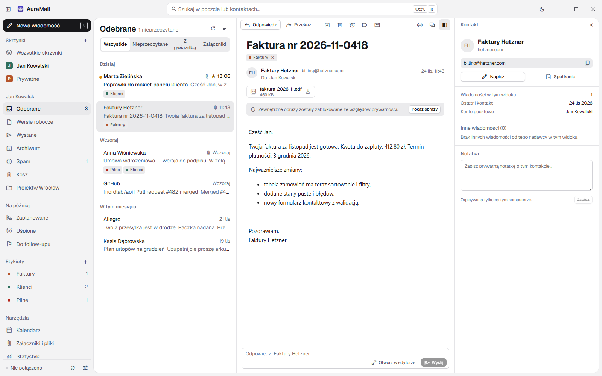
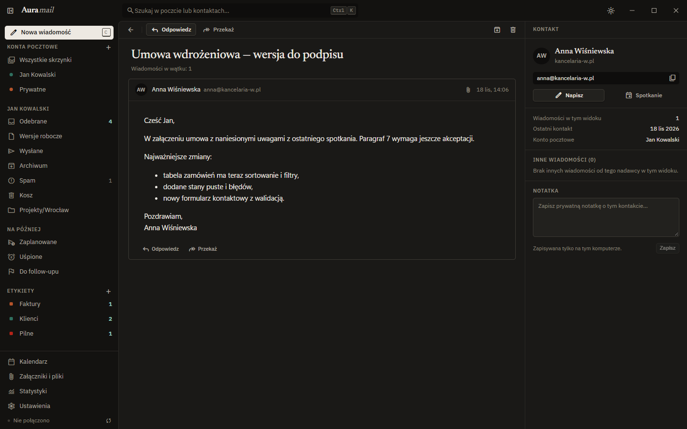
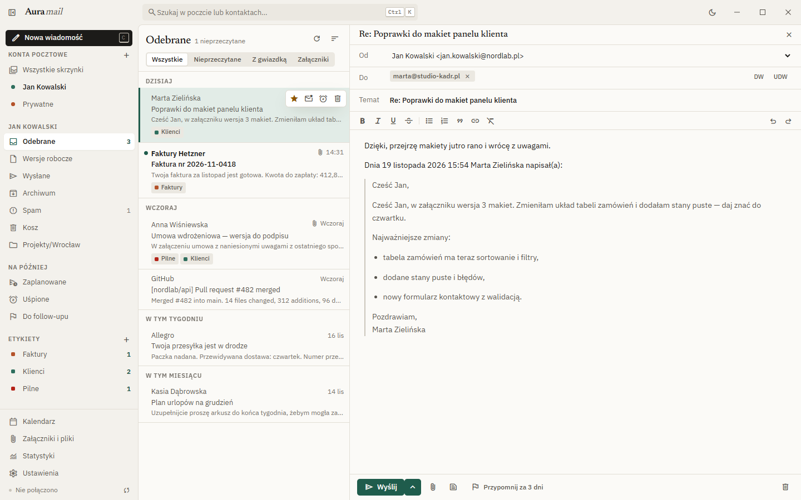
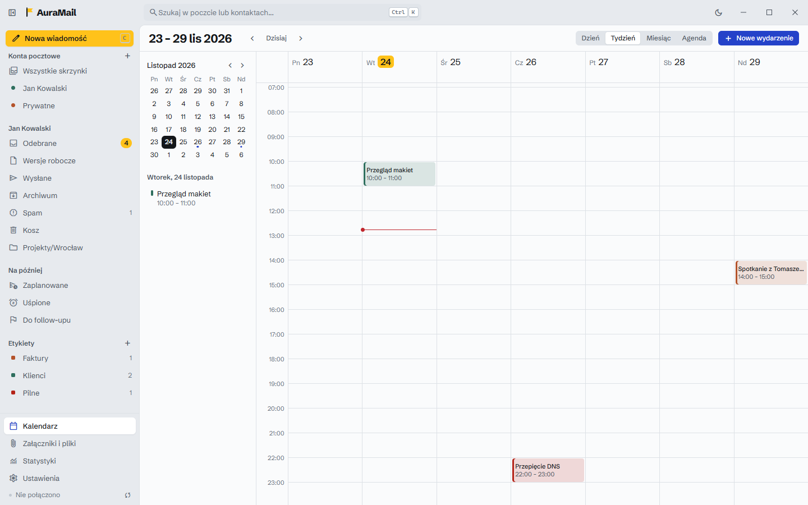

<div align="center">

# AuraMail

**A private, local-first email client for the desktop.**

[](https://github.com/qvbvs/auramail/releases)
[](#installation)
[](./LICENSE)

</div>

<br>

<p align="center">
  
</p>

---

## About

AuraMail is a native email client for Windows and Linux, built around **privacy, performance, and productivity**. Your mail lives locally: encrypted, searchable offline, and free of any unnecessary cloud layer.

Built with **Electron**, **React**, **TypeScript**, and **SQLCipher**.

## Features

- **Encrypted by default**: SQLCipher (AES‑256) database, credentials stored via the OS keychain (DPAPI / Secret Service / KWallet)
- **Real-time sync**: IMAP IDLE push, automatic reconnect, sleep/wake recovery
- **Offline search**: full-text search across your mailbox via SQLite FTS5
- **Rich composer**: Tiptap editor with checklists, code blocks, send later, and snooze
- **One workspace**: integrated calendar, searchable address book, contact timeline, thread notes, automation rules
- **Personalized workspace**: colour accents, message list spacing, and adjustable reading text size
- **Keyboard-first**: global command palette (`Ctrl K`) and full keyboard navigation
- **Multi-account**: unified inbox, each account with its own identity and color
- **Multilingual**: English and Polish interface

## Preview

<p align="center">
  
  
  
</p>

## Architecture

Isolated Electron processes connected by a secure IPC boundary.

```
Renderer  (React · Tailwind · Zustand)
    │
  secure IPC
    │
Main process  (Mail · SMTP · Sync · Calendar · Scheduler)
    │
 ┌──┴───────┐
 SQLCipher   OS Keychain
```

<sub>Full breakdown in <a href="./ARCHITECTURE.md">ARCHITECTURE.md</a>.</sub>

## Tech stack

|  |  |
|---|---|
| Desktop | Electron 33 |
| Language | TypeScript 5 |
| UI | React 18 · Tailwind CSS · Tiptap · Geist (bundled) |
| Mail | IMAPFlow · Nodemailer · MailParser |
| Storage | SQLite + SQLCipher · FTS5 |
| Editor | Tiptap |
| State | Zustand |
| Credentials | Keytar · Electron `safeStorage` |
| Testing | Vitest · Playwright |

## Installation

Download an installer or AppImage from [GitHub Releases](https://github.com/qvbvs/AuraMail/releases).

AuraMail 0.3.0 and later check for new stable releases on launch and every 15 minutes while running. Updates download in the background and install when you choose **Quit** from the system tray. Choose **Install Update and Restart** to apply a downloaded update immediately. Linux package installers may ask for administrator approval.

### Running from source

**Requirements:** Node.js 24+, Git, C/C++ build tools (plus `libsecret` dev headers on Linux)

```bash
git clone https://github.com/qvbvs/auramail.git
cd auramail
npm install
npm run setup   # rebuilds native modules for Electron's ABI
npm run dev
```

On Wayland: `npm run dev -- --ozone-platform-hint=auto`

<details>
<summary>Linux dependencies</summary>
<br>

```bash
# Debian / Ubuntu / Mint / Pop!_OS
sudo apt install build-essential libsecret-1-dev python3

# Fedora / RHEL
sudo dnf install make gcc-c++ libsecret-devel python3

# Arch / Manjaro
sudo pacman -S base-devel libsecret python
```

Tested on GNOME, KDE Plasma, XFCE and Cinnamon, under both X11 and Wayland.

</details>

## Security

- Mail data is stored in a local **SQLCipher-encrypted** SQLite database (AES-256)
- The encryption key is protected per-install via Electron's `safeStorage` (Windows DPAPI / Linux Secret Service)
- Account credentials live in the OS credential manager via `keytar`, never in the app database
- Hardened Electron: `contextIsolation`, `sandbox`, no `nodeIntegration`; external links open in the system browser

Found a vulnerability? See [SECURITY.md](./SECURITY.md).

## Keyboard shortcuts

| Shortcut | Action |
|---|---|
| `Ctrl K` | Command palette |
| `C` | New message |
| `/` | Focus mail search |
| `Shift I` | Go to Inbox |
| `Shift S` | Sync all accounts |
| `F6` / `Shift F6` | Move between search, message list, and reader |
| `↑` / `↓` or `K` / `J` | Select previous / next message in the list |
| `S` / `U` / `P` | Toggle star / read status / pin in the list |
| `E` / `Delete` | Archive / move to trash from the list |
| `R` / `F` | Reply / forward |
| `Ctrl Enter` | Send from the composer or quick reply |
| `Esc` | Close the active dialog, menu, or composer |
| `?` | Show keyboard shortcuts |

## Build

```bash
npm run typecheck   # type checking
npm test            # tests
npm run lint        # lint

npm run build:win     # Windows
npm run build:linux   # Linux
npm run build:all     # all platforms
```

Artifacts land in `dist/`: `.exe`/NSIS on Windows, `.AppImage`/`.deb`/`.rpm` on Linux.

## Roadmap

- [ ] Advanced automation rules
- [ ] Additional calendar integrations
- [x] Improved contact management
- [x] More customization options
- [x] Extended keyboard workflows

## Contributing

Contributions and bug reports are welcome. Please read [CONTRIBUTING.md](./CONTRIBUTING.md) before opening a PR.

---

<div align="center">
<sub>MIT © 2026 qvbvs · <a href="https://github.com/qvbvs/auramail">GitHub</a> · <a href="https://github.com/qvbvs/auramail/releases">Releases</a></sub>
</div>
